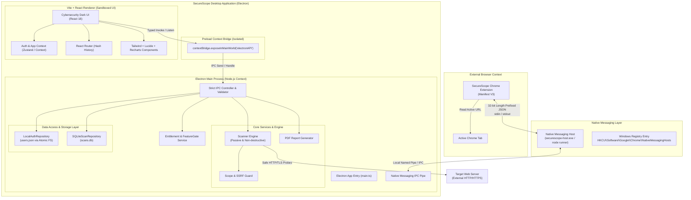
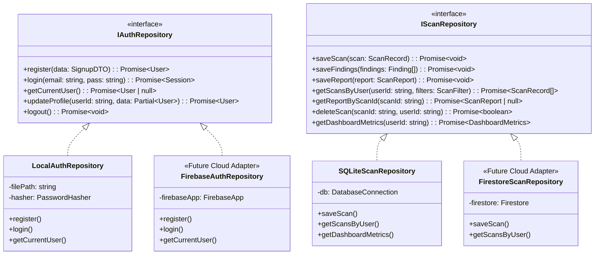

# SecureScope — System Architecture Specification

## 1. Executive Summary & Architectural Vision
SecureScope is a multi-tier desktop security assessment application engineered for website owners, security auditors, and developers. Built on Electron, React, TypeScript, and SQLite, it offers passive, safe, non-destructive security configuration evaluations.

The architecture emphasizes:
- **Defense in Depth**: Strict Electron process isolation with zero raw node APIs in the renderer.
- **Pluggable Repositories**: Abstract interfaces for Authentication, Scans, Reports, and Subscriptions allowing a seamless future migration to Firebase/Firestore without rewriting UI logic.
- **Safe Assessment Engine**: An isolated scanner pipeline designed exclusively for non-invasive passive assessments with built-in SSRF guards.
- **Companion Chrome Extension**: Seamless Manifest V3 extension linked via Windows Chrome Native Messaging.

---

## 2. High-Level System Architecture Diagram



---

## 3. Process Boundaries & Separation of Concerns

### A. Electron Main Process (`apps/desktop/src/main/`)
- **Responsibilities**:
  - Window lifecycle and power management.
  - Native OS integration, safe file path resolution (`app.getPath('userData')`).
  - Strict IPC endpoints with Zod payload validation.
  - Scanner orchestration and network probe execution.
  - SQLite database management and user JSON storage.
  - Feature entitlement validation (ensuring free users cannot trigger premium actions even if UI is bypassed).
  - Native Messaging bridge coordination.

### B. Electron Preload Script (`apps/desktop/src/preload/index.ts`)
- **Responsibilities**:
  - Securely injects a strongly-typed `window.electronAPI` into the renderer.
  - Wraps `ipcRenderer.invoke` and `ipcRenderer.on` with specific channel white-lists.
  - Zero leakage of Electron internals or Node primitives (`Buffer`, `process`, `require`).

### C. Renderer Process (`apps/desktop/src/renderer/`)
- **Responsibilities**:
  - High-performance UI rendering with React 18, Vite, and Tailwind CSS.
  - Routing via `HashRouter` (ensuring compatibility with Electron `file://` protocol in packaged builds).
  - Form validation with React Hook Form and Zod schemas.
  - Visual analytics with Recharts (severity distribution, posture breakdown).
  - Responsive layout for desktop viewport targets (minimum 1280x800).

---

## 4. Repository Abstraction Pattern (Future Firebase Readiness)

To guarantee that the frontend code never needs to be rewritten when transitioning from local storage to Firebase (Auth, Firestore, Cloud Storage), all data access is mediated through domain repository interfaces:



---

## 5. IPC Interface Contract (`window.electronAPI`)

All communication between the renderer and main process is strictly typed.

```typescript
export interface IElectronAPI {
  // Authentication Channels
  auth: {
    signup: (payload: SignupRequest) => Promise<AuthResponse>;
    login: (payload: LoginRequest) => Promise<AuthResponse>;
    logout: () => Promise<void>;
    getCurrentSession: () => Promise<UserSession | null>;
    updateProfile: (payload: UpdateProfileRequest) => Promise<User>;
  };

  // Scanner Channels
  scanner: {
    startScan: (payload: StartScanRequest) => Promise<{ scanId: string }>;
    cancelScan: (scanId: string) => Promise<boolean>;
    onScanProgress: (callback: (progress: ScanProgressEvent) => void) => () => void;
    onScanCompleted: (callback: (report: ScanReport) => void) => () => void;
    onScanError: (callback: (err: ScanErrorEvent) => void) => () => void;
  };

  // Reports & History Channels
  reports: {
    getDashboardMetrics: () => Promise<DashboardMetrics>;
    getHistory: (filter: HistoryFilter) => Promise<ScanSummaryItem[]>;
    getReportDetails: (scanId: string) => Promise<ScanReport>;
    deleteScan: (scanId: string) => Promise<boolean>;
    exportPdf: (scanId: string) => Promise<{ success: boolean; filePath?: string; error?: string }>;
  };

  // Subscription & Entitlements
  subscription: {
    getEntitlements: () => Promise<UserEntitlements>;
    simulateUpgrade: (plan: 'premium') => Promise<SubscriptionResult>;
  };

  // Chrome Extension Linkage
  extension: {
    getConnectionStatus: () => Promise<ExtensionConnectionStatus>;
    onExtensionScanTriggered: (callback: (req: ExtensionScanRequest) => void) => () => void;
  };
}
```

---

## 6. Security Boundaries & Threat Modeling

1. **Context Isolation**: Main and Renderer run in distinct memory contexts. Preload exposes only explicitly defined invoke handlers.
2. **SSRF Guarding**: The Scanner engine performs DNS resolution before connecting. If a resolved IP matches RFC1918 (10.0.0.0/8, 172.16.0.0/12, 192.168.0.0/16) or Loopback/Link-local (127.0.0.0/8, 169.254.0.0/16), the scan is aborted immediately unless explicit "Local Demo Test Mode" is enabled by the developer.
3. **Sensitive Evidence Redaction**: Cookie values, query authentication parameters, authorization tokens, and API keys are redacted with `[REDACTED]` tokens prior to saving to SQLite or rendering in the UI.
4. **Main Process Entitlement Enforcement**:
   - Free users attempting an `aggressive` or `private` scan will be rejected by `EntitlementService` in the Main Process with `HTTP 403 / ENTITLEMENT_REQUIRED`, regardless of frontend tampering.
   - Free users attempting PDF export will be blocked in the Main Process.

---

## 7. Companion Chrome Extension Architecture

- **Extension Type**: Manifest V3 Chrome Extension.
- **Protocol**: Chrome Native Messaging over Standard I/O (stdin/stdout).
- **Framing**: Native messaging packets start with a 32-bit unsigned integer (native byte order) specifying the byte length of the UTF-8 serialized JSON payload.
- **Workflow**:
  1. User navigates to a website and clicks the SecureScope extension icon.
  2. Popup queries `chrome.tabs.query({ active: true, currentWindow: true })`.
  3. User confirms authorization and picks scan mode (`Normal` for free, `Aggressive`/`Private` if premium).
  4. Extension sends message via `chrome.runtime.sendNativeMessage("com.securescope.desktop", payload)`.
  5. Desktop Native Messaging Host validates payload, forwards to Electron Main over local IPC.
  6. Desktop executes the scan, saves report to SQLite, and pushes progress/completion back to extension.

