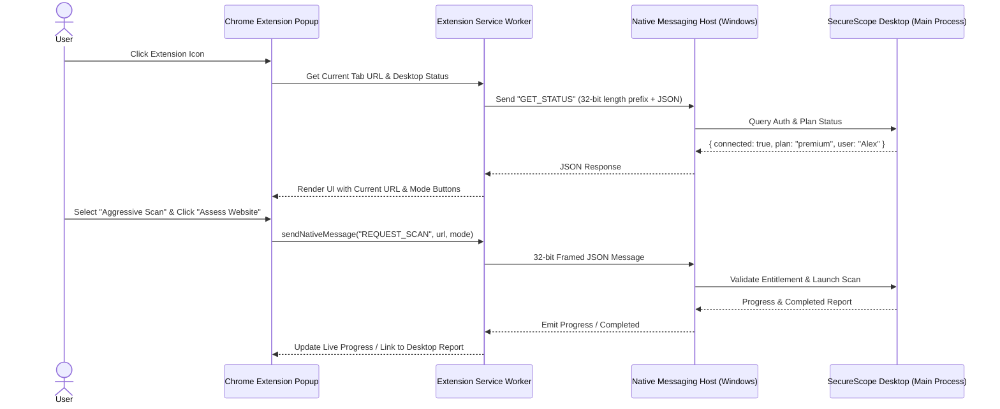

# SecureScope — Chrome Extension & Native Messaging Setup Guide

## 1. Overview & Architecture
The SecureScope Chrome Extension is a companion feature for Premium users that permits initiating authorized website security assessments directly from Google Chrome without copy-pasting URLs.

### Security Model:
- **Zero Automatic Scanning**: The extension *never* scans pages automatically on navigation. An assessment is triggered *only* when the user manually opens the popup, verifies the target, declares authorization, and clicks **Start Scan**.
- **Desktop Main Process Validation**: The extension never carries out the scan itself. It delegates the request to the desktop application via **Chrome Native Messaging**. The desktop application independently verifies the user's session, subscription entitlement, and SSRF restrictions before initiating the assessment.



---

## 2. Chrome Extension Manifest (`apps/chrome-extension/manifest.json`)
Using **Manifest V3**:

```json
{
  "manifest_version": 3,
  "name": "SecureScope Companion",
  "version": "1.0.0",
  "description": "Companion website security assessment launcher for the SecureScope Desktop platform.",
  "icons": {
    "16": "assets/icon-16.png",
    "48": "assets/icon-48.png",
    "128": "assets/icon-128.png"
  },
  "action": {
    "default_popup": "src/popup/index.html",
    "default_icon": {
      "16": "assets/icon-16.png",
      "48": "assets/icon-48.png",
      "128": "assets/icon-128.png"
    }
  },
  "background": {
    "service_worker": "src/service-worker/background.js",
    "type": "module"
  },
  "permissions": [
    "activeTab",
    "nativeMessaging"
  ],
  "host_permissions": []
}
```

*Note: Notice `permissions` only requests `activeTab` (retrieving URL only on user click) and `nativeMessaging`. No wide host permissions or background tracking.*

---

## 3. Windows Native Messaging Host Configuration

### A. Host Manifest (`com.securescope.desktop.json`)
Chrome discovers the native messaging application by reading a JSON manifest file registered in the Windows Registry:

```json
{
  "name": "com.securescope.desktop",
  "description": "SecureScope Desktop Native Messaging Host",
  "path": "C:\\Users\\DELL\\AppData\\Roaming\\SecureScope\\host\\securescope-host.bat",
  "type": "stdio",
  "allowed_origins": [
    "chrome-extension://<CHROME_EXTENSION_ID>/"
  ]
}
```

### B. Windows Registry Key
Chrome reads the registry to locate the host manifest:
- **Key Path**:
  `HKEY_CURRENT_USER\Software\Google\Chrome\NativeMessagingHosts\com.securescope.desktop`
- **Default Value**:
  `C:\Users\DELL\AppData\Roaming\SecureScope\host\com.securescope.desktop.json`

---

## 4. Native Messaging Binary Wire Protocol
Messages exchanged between Chrome and the native messaging host use standard input (`stdin`) and standard output (`stdout`):
1. Each message is serialized as a UTF-8 encoded JSON string.
2. The message is preceded by a **32-bit unsigned integer in native byte order (little-endian on Windows)** indicating the length of the JSON string in bytes.
3. Maximum message length is **1 MB (1,048,576 bytes)**.

### Example Node.js Buffer Framing:
```typescript
// Reading from stdin
function readMessage(chunk: Buffer): object {
  const messageLength = chunk.readUInt32LE(0);
  const jsonString = chunk.subarray(4, 4 + messageLength).toString('utf-8');
  return JSON.parse(jsonString);
}

// Writing to stdout
function writeMessage(payload: object) {
  const jsonBuffer = Buffer.from(JSON.stringify(payload), 'utf-8');
  const lengthBuffer = Buffer.alloc(4);
  lengthBuffer.writeUInt32LE(jsonBuffer.length, 0);
  process.stdout.write(Buffer.concat([lengthBuffer, jsonBuffer]));
}
```

---

## 5. Step-by-Step Installation & Verification Guide

### Step 1: Build & Load the Chrome Extension
1. Open Google Chrome and navigate to `chrome://extensions/`.
2. Toggle the **Developer mode** switch in the top-right corner.
3. Click the **Load unpacked** button.
4. Select the directory:
   `<SecureScope_ROOT>/apps/chrome-extension/dist` (or `apps/chrome-extension/`).
5. Copy the generated **Extension ID** (e.g. `abcdefghijklmnop...`).

### Step 2: Register the Native Host in Windows
1. SecureScope includes an automated setup script:
   `npm run register:extension` (located in `scripts/register-extension.js`).
2. The script:
   - Updates `allowed_origins` in `com.securescope.desktop.json` with your Extension ID.
   - Registers the registry key in `HKCU\Software\Google\Chrome\NativeMessagingHosts\com.securescope.desktop`.
3. Alternatively, run the following PowerShell command:
   ```powershell
   New-Item -Path "HKCU:\Software\Google\Chrome\NativeMessagingHosts\com.securescope.desktop" -Force
   Set-ItemProperty -Path "HKCU:\Software\Google\Chrome\NativeMessagingHosts\com.securescope.desktop" -Name "(default)" -Value "C:\Users\DELL\AppData\Roaming\SecureScope\host\com.securescope.desktop.json"
   ```

### Step 3: Test Connection
1. Launch SecureScope desktop application.
2. Open Chrome, browse to any authorized website (e.g., `https://example.com`), and click the SecureScope extension icon.
3. The popup will display:
   - Green indicator: **"Connected to SecureScope Desktop"**.
   - Current plan: **"PREMIUM ACTIVE"** (or Free Tier indicator).
   - Target URL prefilled.
4. Select scan mode and click **"Start Scan"**. The desktop app will focus and start executing the scan immediately.

