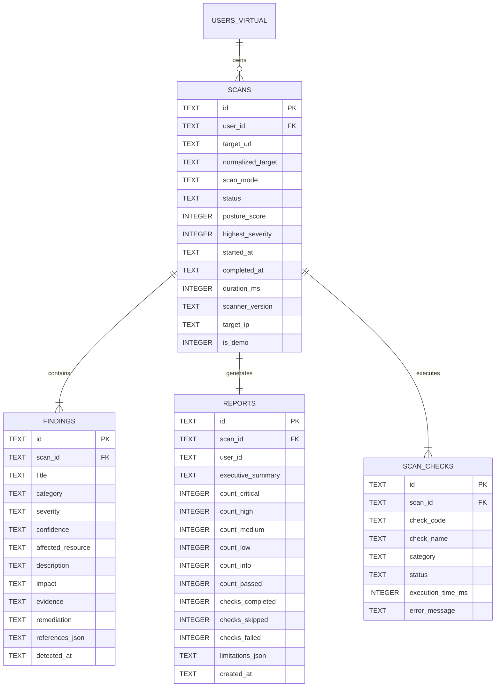

# SecureScope — Database & Persistence Schema Specification

## 1. Storage Overview
SecureScope employs a dual-storage strategy optimized for local desktop deployment, data portability, and high-performance querying:
1. **User Authentication Storage**: Versioned JSON file (`users.json`) stored in the operating system's application data directory.
2. **Scan, Findings & Report Storage**: Relational SQLite database (`scans.db`) providing ACID compliance, foreign key integrity, and index-accelerated query performance for reports and history.

Both stores reside in:
`%APPDATA%/SecureScope/data/` (Windows) or `~/.config/SecureScope/data/` (Linux / macOS).

---

## 2. User JSON Authentication Store (`users.json`)

### Location:
`<userData>/SecureScope/data/users.json`

### File Format:
```json
{
  "schemaVersion": 1,
  "updatedAt": "2026-11-05T12:00:00.000Z",
  "users": [
    {
      "id": "usr_9f4b7a1e2d",
      "firstName": "Alex",
      "lastName": "Vance",
      "email": "alex.vance@example.com",
      "passwordHash": "$scrypt$N=16384,r=8,p=1$c2FsdF9leGFtcGxl...$hash...",
      "plan": "free",
      "subscription": {
        "status": "inactive",
        "planId": "free",
        "startedAt": null,
        "expiresAt": null,
        "priceInr": 0,
        "currency": "INR"
      },
      "avatar": null,
      "createdAt": "2026-11-05T12:00:00.000Z",
      "updatedAt": "2026-11-05T12:00:00.000Z"
    }
  ]
}
```

### Persistence Guarantees:
- **Atomic Writes**: Writes are executed to `users.json.tmp` and then atomically renamed via `fs.promises.rename` to prevent corruption if the application exits mid-write.
- **Normalization**: Emails are always lowercased and trimmed before storage or comparison.
- **Unique Identifiers**: Generated using high-entropy random identifiers (`usr_` + 16 random hex characters).

---

## 3. SQLite Relational Schema (`scans.db`)

The SQLite database enforces foreign key constraints (`PRAGMA foreign_keys = ON;`) and WAL mode (`PRAGMA journal_mode = WAL;`) for concurrent read/write stability.

### Entity-Relationship Diagram



---

## 4. SQL DDL Table Definitions

```sql
-- Enable foreign keys & WAL mode
PRAGMA foreign_keys = ON;
PRAGMA journal_mode = WAL;

-- 1. Schema Migrations Table
CREATE TABLE IF NOT EXISTS schema_migrations (
    version INTEGER PRIMARY KEY,
    applied_at TEXT NOT NULL
);

-- 2. Scans Table
CREATE TABLE IF NOT EXISTS scans (
    id TEXT PRIMARY KEY,
    user_id TEXT NOT NULL,
    target_url TEXT NOT NULL,
    normalized_target TEXT NOT NULL,
    scan_mode TEXT NOT NULL CHECK(scan_mode IN ('normal', 'aggressive', 'private')),
    status TEXT NOT NULL CHECK(status IN ('pending', 'running', 'completed', 'failed', 'cancelled')),
    posture_score INTEGER DEFAULT 0,
    highest_severity TEXT DEFAULT 'INFORMATIONAL' CHECK(highest_severity IN ('CRITICAL', 'HIGH', 'MEDIUM', 'LOW', 'INFORMATIONAL', 'NONE')),
    started_at TEXT NOT NULL,
    completed_at TEXT,
    duration_ms INTEGER DEFAULT 0,
    scanner_version TEXT NOT NULL,
    target_ip TEXT,
    is_demo INTEGER DEFAULT 0 CHECK(is_demo IN (0, 1))
);

CREATE INDEX IF NOT EXISTS idx_scans_user_started ON scans(user_id, started_at DESC);
CREATE INDEX IF NOT EXISTS idx_scans_target ON scans(normalized_target);

-- 3. Findings Table
CREATE TABLE IF NOT EXISTS findings (
    id TEXT PRIMARY KEY,
    scan_id TEXT NOT NULL,
    title TEXT NOT NULL,
    category TEXT NOT NULL,
    severity TEXT NOT NULL CHECK(severity IN ('CRITICAL', 'HIGH', 'MEDIUM', 'LOW', 'INFORMATIONAL')),
    confidence TEXT NOT NULL CHECK(confidence IN ('CONFIRMED', 'HIGH', 'MEDIUM', 'LOW')),
    affected_resource TEXT NOT NULL,
    description TEXT NOT NULL,
    impact TEXT NOT NULL,
    evidence TEXT,
    remediation TEXT NOT NULL,
    references_json TEXT, -- Serialized JSON array of reference URLs/CWEs
    detected_at TEXT NOT NULL,
    FOREIGN KEY(scan_id) REFERENCES scans(id) ON DELETE CASCADE
);

CREATE INDEX IF NOT EXISTS idx_findings_scan_severity ON findings(scan_id, severity);

-- 4. Reports Table
CREATE TABLE IF NOT EXISTS reports (
    id TEXT PRIMARY KEY,
    scan_id TEXT NOT NULL UNIQUE,
    user_id TEXT NOT NULL,
    executive_summary TEXT NOT NULL,
    count_critical INTEGER DEFAULT 0,
    count_high INTEGER DEFAULT 0,
    count_medium INTEGER DEFAULT 0,
    count_low INTEGER DEFAULT 0,
    count_info INTEGER DEFAULT 0,
    count_passed INTEGER DEFAULT 0,
    checks_completed INTEGER DEFAULT 0,
    checks_skipped INTEGER DEFAULT 0,
    checks_failed INTEGER DEFAULT 0,
    limitations_json TEXT NOT NULL, -- Serialized JSON array of limitations strings
    created_at TEXT NOT NULL,
    FOREIGN KEY(scan_id) REFERENCES scans(id) ON DELETE CASCADE
);

CREATE INDEX IF NOT EXISTS idx_reports_user ON reports(user_id, created_at DESC);

-- 5. Scan Checks Table
CREATE TABLE IF NOT EXISTS scan_checks (
    id TEXT PRIMARY KEY,
    scan_id TEXT NOT NULL,
    check_code TEXT NOT NULL,
    check_name TEXT NOT NULL,
    category TEXT NOT NULL,
    status TEXT NOT NULL CHECK(status IN ('passed', 'failed', 'skipped', 'error')),
    execution_time_ms INTEGER DEFAULT 0,
    error_message TEXT,
    FOREIGN KEY(scan_id) REFERENCES scans(id) ON DELETE CASCADE
);

CREATE INDEX IF NOT EXISTS idx_checks_scan ON scan_checks(scan_id);
```

---

## 5. TypeScript Domain Types

```typescript
export type ScanMode = 'normal' | 'aggressive' | 'private';
export type ScanStatus = 'pending' | 'running' | 'completed' | 'failed' | 'cancelled';
export type SeverityLevel = 'CRITICAL' | 'HIGH' | 'MEDIUM' | 'LOW' | 'INFORMATIONAL';
export type ConfidenceLevel = 'CONFIRMED' | 'HIGH' | 'MEDIUM' | 'LOW';

export interface ScanRecord {
  id: string;
  userId: string;
  targetUrl: string;
  normalizedTarget: string;
  scanMode: ScanMode;
  status: ScanStatus;
  postureScore: number;
  highestSeverity: SeverityLevel | 'NONE';
  startedAt: string;
  completedAt?: string;
  durationMs: number;
  scannerVersion: string;
  targetIp?: string;
  isDemo: boolean;
}

export interface Finding {
  id: string;
  scanId: string;
  title: string;
  category: string;
  severity: SeverityLevel;
  confidence: ConfidenceLevel;
  affectedResource: string;
  description: string;
  impact: string;
  evidence: string;
  remediation: string;
  references: string[];
  detectedAt: string;
}

export interface ScanReport {
  id: string;
  scanId: string;
  userId: string;
  scan: ScanRecord;
  findings: Finding[];
  executiveSummary: string;
  findingCounts: {
    critical: number;
    high: number;
    medium: number;
    low: number;
    informational: number;
    passed: number;
  };
  checks: {
    completed: number;
    skipped: number;
    failed: number;
  };
  limitations: string[];
  createdAt: string;
}
```

---

## 6. Future Cloud Architecture Alignment (Firestore)
When migrating to Google Cloud / Firebase:
- `users.json` maps directly to Firebase Authentication (`auth.UserRecord`) and the `/users/{userId}` Firestore collection.
- `scans` table maps to `/users/{userId}/scans/{scanId}` collection.
- `findings` table maps to `/users/{userId}/scans/{scanId}/findings/{findingId}` subcollection.
- Reports and PDF binaries stream to Firebase Cloud Storage at `gs://securescope-reports/{userId}/{scanId}.pdf`.
Because all repository operations pass through `IScanRepository` and `IAuthRepository`, the renderer code remains 100% unchanged during the migration.

