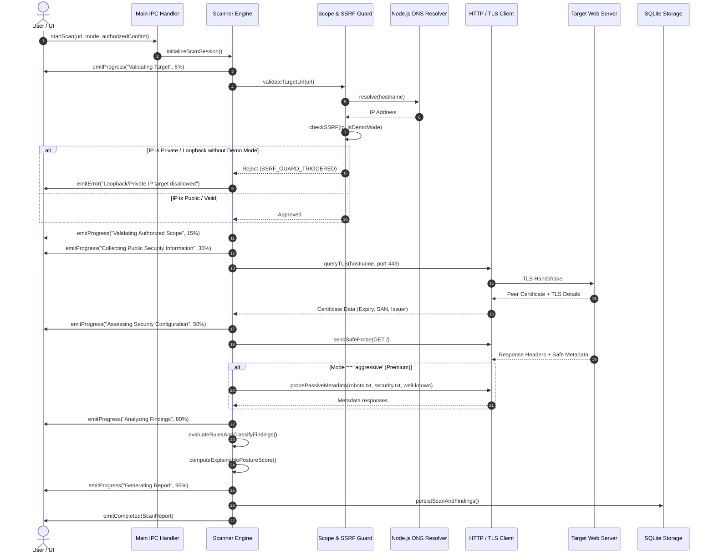

# SecureScope — Security Assessment Engine Design Specification

## 1. Core Principles & Philosophy
The SecureScope assessment engine is engineered for **safe, passive, non-destructive, and educational security evaluations** of web applications. It empowers website administrators and security learners to assess defensive posture without generating invasive traffic, disrupting services, or violating legal boundaries.

### Safety Guarantee:
- **Zero Active Exploitation**: The engine never injects malicious code, SQL injection vectors, or cross-site scripting (XSS) payloads.
- **Zero Brute Force / Fuzzing**: No credential attacks, directory dictionaries, or high-volume request bursts.
- **Strictly Bounded Requests**: Maximum request rate is governed (max 2 req/s for Normal, 5 req/s for Aggressive), with hard per-request timeouts (8,000ms).
- **Zero Evasion or Stealth**: The engine never attempts to bypass Web Application Firewalls (WAFs), hide user-agent strings, or disguise traffic origins.

---

## 2. Assessment Architecture & Pipeline

---

## 3. Scope & SSRF (Server-Side Request Forgery) Guard
To prevent SecureScope from being abused as a local network proxy or scanning internal intranets, all URLs pass through the `ScopeValidator`:

1. **Protocol Check**: Only `http:` and `https:` schemes are accepted. `file:`, `ftp:`, `gopher:`, `javascript:`, `data:` are blocked.
2. **DNS Resolution & IP Verification**:
   The engine resolves target hostnames to IPv4/IPv6 addresses before making socket or HTTP connections.
   The following CIDR blocks are rejected by default:
   - `127.0.0.0/8` (Loopback)
   - `10.0.0.0/8` (Private RFC1918)
   - `172.16.0.0/12` (Private RFC1918)
   - `192.168.0.0/16` (Private RFC1918)
   - `169.254.0.0/16` (Link-Local)
   - `::1` (IPv6 Loopback)
   - `fc00::/7` (IPv6 Unique Local)
3. **Local Demo Assessment Mode**:
   A specific, explicitly labeled demo mode (`DEMO MODE: Target localhost:8000`) is supported exclusively when the user checks "Enable Local Test Sandbox". In all other modes, local and private addresses are rejected.
4. **Redirect Policy**:
   Redirects are tracked up to a maximum of 3 hops. Cross-domain redirects trigger a scope reassessment; if the destination domain resolves to a disallowed private address, the scan terminates immediately.

---

## 4. Scan Modes & Feature Matrix

| Capability / Check | Normal Scan (Free) | Aggressive Scan (Premium) | Private Scan (Premium) |
| :--- | :---: | :---: | :---: |
| **Cost** | ₹0 (Free Forever) | Included in Premium | Included in Premium |
| **HTTPS & TLS Certificate Audit** | Yes | Yes (Detailed) | Yes |
| **HSTS Verification** | Yes | Yes | Yes |
| **Content Security Policy (CSP)** | Yes | Yes (Directive Analysis) | Yes |
| **X-Frame-Options (Clickjacking)** | Yes | Yes | Yes |
| **X-Content-Type-Options (MIME Sniffing)** | Yes | Yes | Yes |
| **Referrer-Policy & Permissions-Policy** | Yes | Yes | Yes |
| **Cookie Flags (Secure, HttpOnly, SameSite)** | Yes | Yes | Yes |
| **Server & Technology Disclosure Leakage** | Yes | Yes | Yes |
| **robots.txt & security.txt Compliance** | No | Yes | No |
| **CORS Misconfiguration Check (Safe probe)** | No | Yes | No |
| **Directory Indexing Passive Observation** | No | Yes | No |
| **TLS 1.0 / 1.1 Deprecation Flagging** | No | Yes | No |
| **Evidence Sanitization & Minimization** | Standard | Standard | Maximum (Zero bodies, redacted headers) |
| **Downloadable PDF Report** | No (In-app only) | Yes (Executive PDF) | Yes (Executive PDF) |

---

## 5. Security Checks Breakdown

### Check 1: TLS / Certificate Health
- **Severity**: Critical (Expired/Invalid) | Medium (Nearing Expiry < 14 days) | Low (Weak Key Size)
- **Method**: Evaluates socket peer certificate validity, days until expiration, common name vs host match, and issuer trust.

### Check 2: Strict-Transport-Security (HSTS)
- **Severity**: High (Missing) | Medium (max-age < 15552000 / 180 days) | Low (missing `includeSubDomains`)
- **Remediation**: Add `Strict-Transport-Security: max-age=31536000; includeSubDomains; preload`.

### Check 3: Content-Security-Policy (CSP)
- **Severity**: High (Missing or using `unsafe-inline` / `unsafe-eval` without nonce) | Medium (Missing `default-src` fallback)
- **Remediation**: Formulate a strict CSP restricting script execution, style injection, and object embedding.

### Check 4: Clickjacking Defense (X-Frame-Options / frame-ancestors)
- **Severity**: Medium (Missing protection)
- **Remediation**: Set `X-Frame-Options: DENY` or `SAMEORIGIN`, or define `frame-ancestors 'self'` in CSP.

### Check 5: MIME-Sniffing Defense (X-Content-Type-Options)
- **Severity**: Low
- **Remediation**: Set `X-Content-Type-Options: nosniff`.

### Check 6: Cookie Hardening (Secure, HttpOnly, SameSite)
- **Severity**: Medium (Sensitive cookie missing `Secure` or `HttpOnly`) | Low (`SameSite` missing or None)
- **Remediation**: Configure `Set-Cookie: name=val; Secure; HttpOnly; SameSite=Lax`.

### Check 7: Server Information Disclosure
- **Severity**: Low / Informational
- **Remediation**: Strip verbose banners (`Server: Apache/2.4.41 (Ubuntu)`, `X-Powered-By: PHP/7.4`).

### Check 8: security.txt & Vulnerability Disclosure Standard (Aggressive Mode)
- **Severity**: Informational
- **Remediation**: Publish security contact in `/.well-known/security.txt` per RFC 9116.

### Check 9: Cross-Origin Resource Sharing (CORS) Configuration (Aggressive Mode)
- **Severity**: High (Wildcard origin `*` returned alongside `Access-Control-Allow-Credentials: true`)
- **Remediation**: Validate incoming origin whitelist dynamically and never mirror origin with credentials.

---

## 6. Explainable Security Posture Score Formula
SecureScope computes an explainable 0–100 score:
$$\text{Score} = \max\left(0, 100 - \sum \text{Finding Penalties}\right)$$

### Penalty Deductions:
- Each **CRITICAL** finding: **-30 points**
- Each **HIGH** finding: **-18 points**
- Each **MEDIUM** finding: **-8 points**
- Each **LOW** finding: **-3 points**
- **INFORMATIONAL** findings: **0 points** (informational only)

### Grade Classification:
- **90 – 100**: **Grade A** (Strong Baseline Posture)
- **75 – 89**: **Grade B** (Acceptable, minor hardening needed)
- **50 – 74**: **Grade C** (Moderate Risk, key headers or cookies exposed)
- **30 – 49**: **Grade D** (High Risk, missing fundamental defenses)
- **0 – 29**: **Grade F** (Critical Risk, expired SSL or severe vulnerabilities)

### Disclosure Disclaimer:
The score is explicitly framed as: *"An application-defined defensive configuration metric based on evaluated passive checks. A score of 100 does not certify that the website is immune to attack or free from application-layer vulnerabilities."*

---

## 7. Cancellation & Concurrency Management
- Each active scan initializes an `AbortController`.
- When the user clicks **Cancel Scan** or navigates away, `abortController.abort()` cleanly terminates in-flight socket probes.
- Status is updated to `'cancelled'` in SQLite, and partial findings detected prior to cancellation are safely preserved with an explicit cancellation flag.

